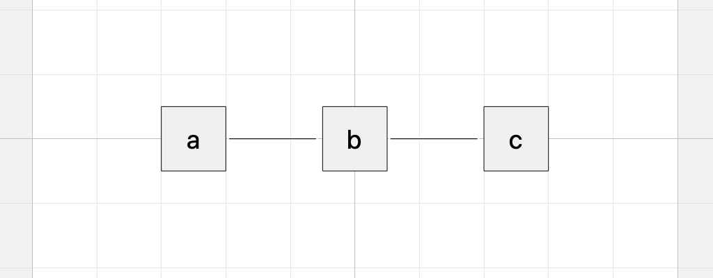
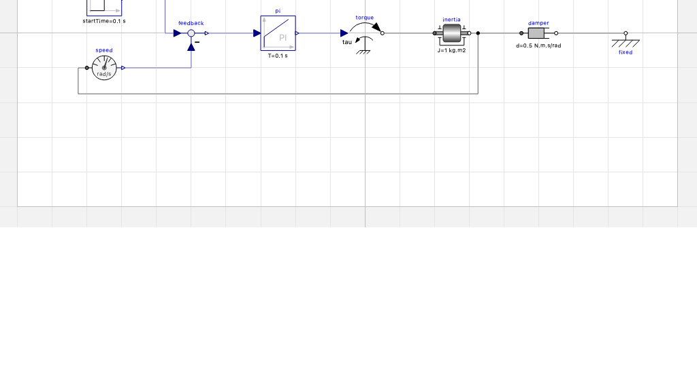

# mocoal-rs

Mocoal (Modelica Component Auto Layout) gives the components of a Modelica model a `Placement` and its connections a `Line`. For models
written as text, without graphical annotations: OMEdit shows such a model as an empty diagram, even
when it has many components and connections. After mocoal it shows every component and every
connection.

Two forms, one crate:

- the standalone program `mocoal`,
- the shared library `libmocoal` (C interface, for tools such as OMEdit).

The source is parsed with OpenModelica's Rust parser. Only annotations are changed: comments,
formatting and everything else in the file stay as they are.

## Example

```modelica
model Chain
  Gain a(k = 2);
  Gain b;
  Gain c "the last one";
equation
  a.u = time;
  connect(a.y, b.u);
  connect(b.y, c.u);
end Chain;
```

`mocoal Chain.mo` prints:

```modelica
model Chain
  Gain a(k = 2) annotation(Placement(transformation(origin={-50,0}, extent={{-10,-10},{10,10}})));
  Gain b annotation(Placement(transformation(origin={0,0}, extent={{-10,-10},{10,10}})));
  Gain c "the last one" annotation(Placement(transformation(origin={50,0}, extent={{-10,-10},{10,10}})));
equation
  a.u = time;
  connect(a.y, b.u) annotation(Line(points={{-39,0},{-12,0}}));
  connect(b.y, c.u) annotation(Line(points={{11,0},{38,0}}));
end Chain;
```

The lines start and end at the connectors of `Gain` (its `u` at x = -120, its `y` at x = 110 in
the icon). The whole file is in [test/models/Chain.mo](test/models/Chain.mo).

Neither the components nor the classes need graphical annotations. The input has no `Placement`
and no `Line`, and `Gain` has no `Icon`: a class without an icon gets the default size, 20 x 20,
and OMEdit draws it as a box with its name. The result in OMEdit 1.27.1:



[examples/Drive.mo](examples/Drive.mo) is a speed control of an inertia with 8 components of the
Modelica Standard Library, written as text: no annotation at all. `mocoal -L
~/.openmodelica/libraries Drive.mo` places the 8 components and routes the 8 connections
([examples/Drive-layout.mo](examples/Drive-layout.mo)): the signal flow from left to right, the
speed sensor's feedback below. In OMEdit 1.27.1:



Both pass OMEdit's check (Chain 6 equations, Drive 32). More in [examples/](examples/README.md):
Drive before and after, and six examples of the Modelica Standard Library, before and after, in
OMEdit.

## Build

Rust 1.99 (stable) and git.

```bash
scripts/fetch-omc.sh
```

```bash
cargo build --release
```

`target/release/mocoal` and `target/release/libmocoal.{so,dylib}` (`mocoal.dll` on Windows).
macOS arm64: `mocoal` 1.6 MB, `libmocoal.dylib` 1.5 MB, no other files needed at run time.

## Command line

```
usage: mocoal [options] file.mo|directory ...
       mocoal [options] --stdin file.mo

Give the components of Modelica models a placement and the connections a line.
One file without -o, -i or -n: the result is printed.

  -o, --output FILE      write the result to FILE (one input file)
      --stdin FILE       read the text of FILE from the standard input (FILE need not
                         exist; its place finds the libraries next to it)
      --stack MB         stack of the layout in MB (256); a level of nesting in the
                         model takes about 3 KB
  -i, --in-place         change the input files
  -n, --dry-run          report only, write nothing
  -c, --class NAME       lay out only this class or package (may be repeated)
  -k, --keep             keep existing placements and lines, add what is missing
      --layout NAME      layered (default), spring, grid
      --route NAME       orthogonal (default), straight, bezier, none
      --direction NAME   right (default), down
      --spacing DX[,DY]  space between components (30,20)
      --scale S          factor on the component size (1)
      --no-rotate        do not turn two-pin components
      --graphics NAME    shapes of the Diagram layer: move (default), keep, drop
  -L, --library DIR      a directory with libraries (may be repeated)
      --svg DIR          write an SVG preview of every diagram into DIR
  -q, --quiet            no report
  -h, --help             this text
      --version          the version
```

A directory is searched for `.mo` files. The report goes to standard error. Exit status: 0, 1 (a
file failed), 2 (command line).

An existing layout is replaced. `--keep` leaves existing placements and lines and adds the
missing ones.

Classes used by a model are looked up in the file, in its package directory, in the `-L`
directories, in `OPENMODELICALIBRARY` and `MODELICAPATH`, and in `~/.openmodelica/libraries`.

## Shared library

```c
char *mocoal_layout(const char *text, const char *file_name, const char *options);
const char *mocoal_message(void);
const char *mocoal_version(void);
void mocoal_free(char *text);
```

- `mocoal_layout` returns the new source, or `NULL` when there is no layout. `file_name` may be
  `NULL` or empty. `options` is a command line as for `mocoal` (`"--route straight --keep"`),
  `NULL` or empty for the defaults; a word may be in double quotes (`-L "/my libs"`). Release the
  result with `mocoal_free`.
- `mocoal_message` gives the error after a `NULL`, and the warnings (one per line) after a layout.
  The text belongs to the library.
- Call the functions from one thread at a time.

[interface/INTERFACE.md](interface/INTERFACE.md) is the specification: what a caller may rely on,
the options, the class lookup, and what an implementation of the library has to do.
[interface/test_lib.c](interface/test_lib.c) is a C program that tests it.

The library also exports 3 symbols of the parser crates (`omrs_add_runtime_error`,
`omrs_add_runtime_error_pos`, `omrs_runtime_abort`). They are not part of the interface.

## Parser

The crate `openmodelica_ast` (`OMCompiler/Compiler/OpenModelica.rs` in
[OpenModelica](https://github.com/OpenModelica/OpenModelica)) gives the `Absyn` tree of omc. It is
linked statically: no OpenModelica installation is needed to build or run.

`scripts/fetch-omc.sh` copies 5 crates (`openmodelica_ast`, `openmodelica_error`,
`openmodelica_wasi`, `metamodelica`, `metamodelica_derive`) and 6 builtin `.mo` files into
`omc/` (1.5 MB), at the commit in [omc/COMMIT](omc/COMMIT). They are not in this repository.
`OPENMODELICA_SRC=<checkout> scripts/fetch-omc.sh` takes them from a local checkout, else they
come from GitHub (38 s). A new parser: change `omc/COMMIT`, fetch, build, run the checks.

## How it works

1. Parse the file (`openmodelica_ast`), and tokenize it for the positions of the edits.
2. Per model, block or class: collect the components that have an icon (connectors, and
   components of classes with connectors) and the `connect` equations. Ports get their place and
   colour from the connector's `Placement` and icon in the component's class, base classes
   included.
3. Place the components: layered (signal flow from left to right; inputs left, outputs right),
   spring or grid. Unconnected components go into a grid.
4. Route the connections: orthogonal lines around the components, straight lines, or Bezier.
5. Write `Placement` and `Line` into the annotations. The diagram's `extent` is written only
   when the content does not fit.

Rules:

- A connector of the class itself is placed in the diagram and keeps its place in the icon: the
  old `transformation` becomes the `iconTransformation`. Without a place it gets one on the
  icon's border (inputs left, outputs right).
- Components whose connectors are all acausal (two-pin electrical, mechanical and thermal parts)
  are turned by 0, 90, 180 or 270 degrees so that their connectors face their neighbours: the
  layout runs, the parts are turned, the layout runs again (up to 3 times). A part with one
  connected connector (a boundary, a sink) is turned when that connector is on the left or right of
  its icon; one with its connector on top (a ground, a fixed flange) is not. `--no-rotate` leaves
  them unturned.
- The shapes of the Diagram layer (`Diagram(graphics={...})`) belong to the old layout:
  a rectangle that held components becomes the frame of those components, a text inside it or up
  to 25 above it moves with the frame, a small rectangle or ellipse (a junction marker) and a
  rectangle that holds nothing are dropped, other shapes move with the nearest component. A
  frame that would cover another component is dropped with its texts. `--graphics keep` leaves
  the shapes, `--graphics drop` removes them.
- A class with only placed connectors and no connections (an interface) is left as it is.
- A component inherited from a base class sits where the base class has it. When the base class
  is laid out in the same run, that is its new place.
- A file that is not UTF-8 is refused.
- A second run on the result changes nothing.

## Source

26 files in `src/`, 7800 lines:

| Folder | Modules | Does |
|---|---|---|
| `src/` | `api`, `capi`, `cli`, `program`, `options`, `numbers` | the Rust API, the C interface, the program, numbers |
| `src/source/` | `absyn`, `tokens`, `lookup`, `resolve` | reads the source text, the Absyn tree and the library classes |
| `src/layout/` | `extract`, `diagram`, `placement`, `layered`, `grid`, `spring`, `ends`, `routing` | builds the diagram, places the components, routes the lines |
| `src/write/` | `annotate`, `graphics`, `svg` | writes the annotations and the SVG previews |

Names follow the rules of the Rust omc: `snake_case`
functions, `CamelCase` types, `SCREAMING_SNAKE_CASE` constants, rustfmt with `max_width = 120`,
errors as `Result`. `src/numbers.rs` has `sind`, `cosd` and the printing of numbers, so that
the output is the same to the last digit on every platform.

## Checks

```bash
cargo test
```

```bash
scripts/check.sh all
```

```bash
cargo fmt -p mocoal -- --check
```

```bash
cargo clippy -p mocoal --all-targets --no-deps -- -D warnings
```

57 tests, 0.3 s. Among them `layouts` in [src/tests.rs](src/tests.rs): 14 cases on the 8 models
in [test/models](test/models) (a cascade control, an RC ladder, a resistor mesh, a drive train, a
chain of 24 gains, the rules of the layout, and the cases of the OpenModelica issues #7232 and
#16959), which use the parts in [test/library/Parts.mo](test/library/Parts.mo), not the MSL
([test/README.md](test/README.md) gives the origin of each file). Each result must equal
its file in [test/expected](test/expected) byte for byte: the `Placement` and `Line` coordinates.
On the laid-out diagram of each class it checks that no two components overlap, every line ends at
its ports, orthogonal lines are axis-aligned and pass through no component, and a second layout
changes nothing; with `--keep`, every `Placement` of the input stays as it was. After an intended
change of the layout:

```bash
MOCOAL_BLESS=1 cargo test -p mocoal layouts
```

then review `git diff test/expected`.

`check.sh [exe|lib|all]` runs the program on
[test/models/Chain.mo](test/models/Chain.mo) and compiles and runs `interface/test_lib.c`
against the library. `cargo fmt` and `cargo clippy` need `-p mocoal` (and clippy `--no-deps`):
without it they work on the fetched crates too.

`scripts/compare.sh MOCOAL_A MOCOAL_B LIBRARY_DIR WORK_DIR [options]` lays out a copy of a
library with two programs and compares the files, the SVG previews and the reports.

Modelica Standard Library 4.1.0, `mocoal -i Modelica`, macOS arm64: 2552 files in 1.1 to 1.5 s,
975 changed, 0 failed; 1182 classes, 8792 components placed, 9622 connections routed. A second
run changes 0 files.

The workflow [.github/workflows/build.yml](.github/workflows/build.yml) runs the checks, builds
both forms and uploads them as artifacts: Linux x86_64 on a push or pull request; Linux, macOS
arm64 and Windows x86_64 on a run by hand (Actions > Build > Run workflow) and for a release.

## Release

By hand on GitHub: Releases > Draft a new release.

1. Choose a tag: type the new tag `v<version>`, `<version>` as in `Cargo.toml` of the commit.
2. Target: the commit, from a branch or Recent commits. It must be on master.
3. Publish release. "Generate release notes" fills in the pull requests.

Publishing makes the tag and starts [.github/workflows/release.yml](.github/workflows/release.yml).
It checks the commit and the tag, builds and tests that commit, and attaches to the release:

- `mocoal-<platform>` and `libmocoal-<platform>` for Linux x86_64, macOS arm64 and Windows
  x86_64 (`.tar.gz`, `.zip` on Windows): the program or the library with `README.md` and the
  licence files, built and tested as by the Build workflow;
- `mocoal-rs-<version>-src.tar.gz`: the complete source. The tree of the commit, the parser crates
  of OpenModelica and the crates.io dependencies (`cargo vendor`): `cargo build --release --offline`
  builds it without network access (8 MB). GitHub's own "Source code" archives lack the parser
  crates;
- `SHA256SUMS` of all of them.

The archives come when the workflow is done. When a step fails (a tag that is not
`v<version>`, a commit not on master, a failed build), the release becomes a draft again and the
tag stays: delete both, fix, and release again. A dry run builds everything and attaches nothing:
Actions > Release > Run workflow (`commit`: empty for the head of master), or a pull request that
changes `release.yml`. A pushed tag starts no release. Nothing is published to crates.io
(`publish = false`).

## Limitations

- Components are not flipped, and only acausal parts are turned. A replaced `Placement` loses
  its rotation and flip; the size of an existing extent is kept. Circuits with many parallel
  branches (ladders) come out worse than hand-made layouts: there are no junction points.
- Modifiers and redeclarations are not applied in the class lookup.
- Connections to inherited components do not influence the placement.
- With `--keep`, existing lines are not obstacles for the new ones.
- `replaceable ... constrainedby ... annotation(...)`: the `Placement` goes into the annotation
  of the constraining clause.

## Licence

OSMC-PL 1.8 or AGPL v3, according to the recipient's choice. See [LICENSE.md](LICENSE.md).
