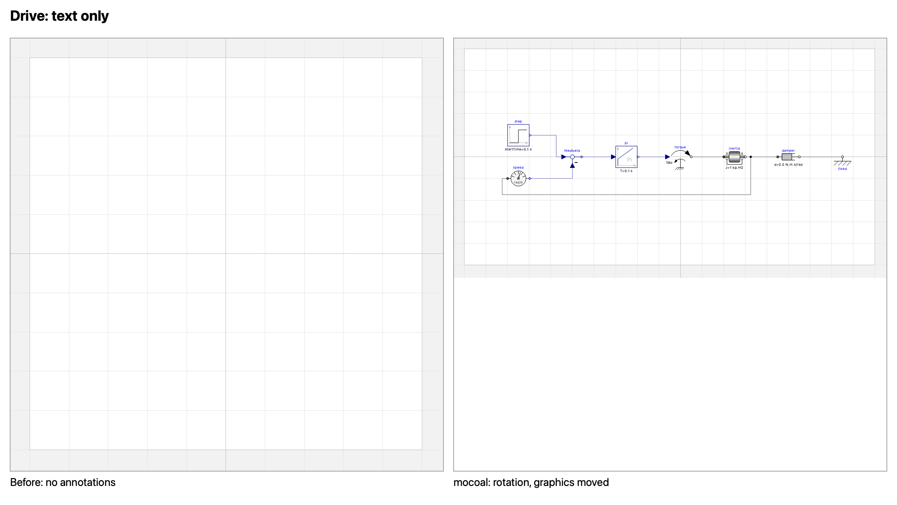
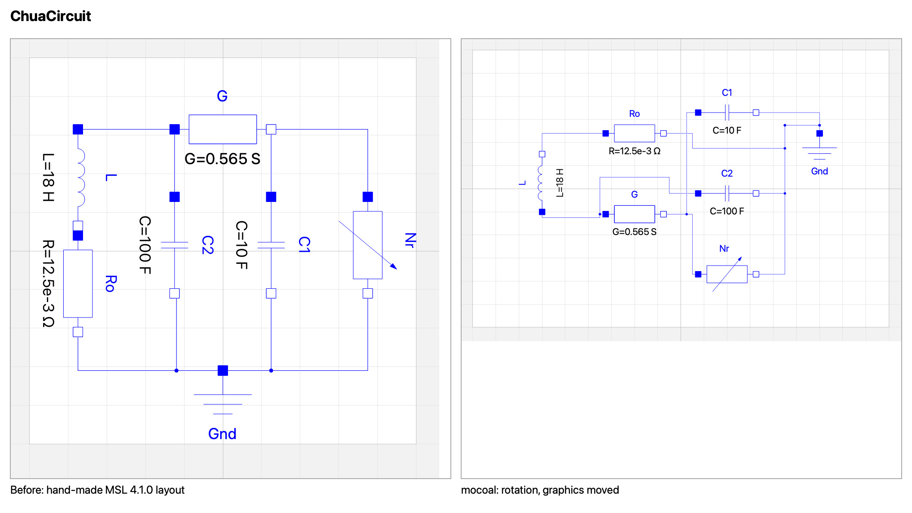

# Examples

Made with `mocoal` 0.1.0. The Julia program
([ModelicaComponentAutolayout.jl](https://github.com/JKRT/ModelicaComponentAutolayout.jl)) and the
Rust program ([mocoal-rs](https://github.com/OpenModelica/mocoal-rs)) give the same files and SVGs, byte
for byte. Both repositories have this directory.

## Drive: a model written as text

[Drive.mo](Drive.mo) has 8 components and 8 connections, and no graphical annotations.
[Drive-layout.mo](Drive-layout.mo) is the result of

```bash
mocoal --svg svg -o Drive-layout.mo Drive.mo
```



## Modelica Standard Library 4.1.0

Six examples with hand-made layouts, laid out again. Left: the library's layout. Right: mocoal's.

```bash
mocoal -n --svg svg -c Modelica.Electrical.Analog.Examples.ChuaCircuit Modelica
```

`Modelica` is the directory of the library. `-n` writes only the SVG; `-i` changes the files.

| Model | Components | Connections | OMEdit | SVG preview |
|---|---|---|---|---|
| Blocks.Examples.PID_Controller | 9 | 9 | [png](omedit/Modelica.Blocks.Examples.PID_Controller.png) | [svg](svg/Modelica.Blocks.Examples.PID_Controller.svg) |
| Electrical.Analog.Examples.ChuaCircuit | 7 | 9 | [png](omedit/Modelica.Electrical.Analog.Examples.ChuaCircuit.png) | [svg](svg/Modelica.Electrical.Analog.Examples.ChuaCircuit.svg) |
| Electrical.Analog.Examples.CauerLowPassAnalog | 11 | 16 | [png](omedit/Modelica.Electrical.Analog.Examples.CauerLowPassAnalog.png) | [svg](svg/Modelica.Electrical.Analog.Examples.CauerLowPassAnalog.svg) |
| Mechanics.Rotational.Examples.First | 9 | 10 | [png](omedit/Modelica.Mechanics.Rotational.Examples.First.png) | [svg](svg/Modelica.Mechanics.Rotational.Examples.First.svg) |
| Mechanics.Rotational.Examples.CoupledClutches | 13 | 12 | [png](omedit/Modelica.Mechanics.Rotational.Examples.CoupledClutches.png) | [svg](svg/Modelica.Mechanics.Rotational.Examples.CoupledClutches.svg) |
| Thermal.HeatTransfer.Examples.TwoMasses | 5 | 4 | [png](omedit/Modelica.Thermal.HeatTransfer.Examples.TwoMasses.png) | [svg](svg/Modelica.Thermal.HeatTransfer.Examples.TwoMasses.svg) |



The six models and their original layouts are from the Modelica Standard Library 4.1.0, 3-Clause
BSD License, Copyright (c) 1998-2025, Modelica Association and contributors (see
[LICENSE.md](../LICENSE.md)). The library's files are not in this repository; `Drive.mo` uses its
classes by name.

The OMEdit pictures are from OpenModelica 1.27.1. The SVG previews are mocoal's own
(`--svg`): boxes for the components, the lines as routed.

CauerLowPassAnalog (a ladder with parallel branches) and CoupledClutches come out worse than the
hand-made layouts: there are no junction points, and components with causal connectors are not
turned.
